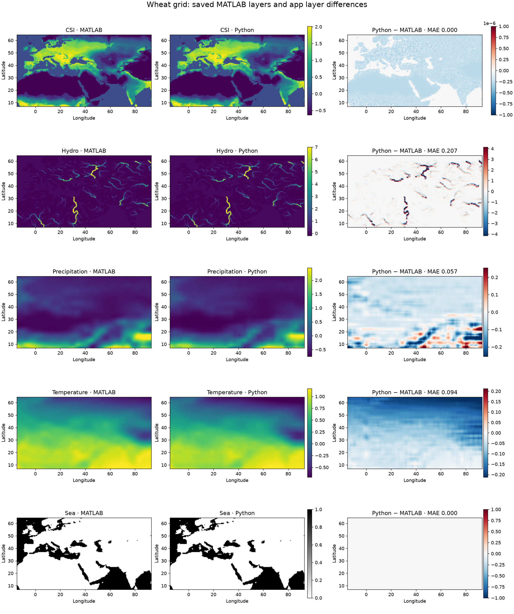

# Development log

## 2026-10-28 10:34 +00:00 — Notebook initialized (Codex)

- Created the six project notebook files without staging or committing.
- Read `README.md` and `processing/DATA_PROCESSING.md` for project context. The latter documents HDF5 inputs, layer processing, crop observations, and estimator grid conventions.
- Initial Git check: `main` at `532e82fcae9f7fff76f734222c228deeb666c80b`. Pre-existing, unstaged modifications: `diffusion_estimator.py`, `fast_marching.py`, `layer_inspection.ipynb`, and `monte_carlo.py`. Pre-existing untracked files: `diffusion_estimator_app_overview.docx`, `make_overview_doc.py`, `spatial_weights.py`, and `tests/test_spatial_weight.py`.
- The observed code diff adds latitude-weight selection to both solvers and estimator calls; this is a description of uncommitted changes, not a validation or attribution. Origin of all pre-existing changes is unknown.
- No application code, data, experiment, or test was changed or run during notebook initialization.
- Created the shared `ProjectNotebooks/INDEX.md` dashboard with project status, links, approved-results state, next step, and activity.
- Next: leave notebook files unstaged for review.

## 2026-10-28 10:42 +00:00 — MATLAB to Python migration review (Codex; revised 10:53)

- **Climate processing:** MATLAB interpolates every 10-year TraCE frame with splines to its fixed 0.5-degree grid, then normalizes the full space-time cube. Python stores native-grid frames every 100 years, averages selected frames, interpolates linearly to the requested `delta`, then normalizes the global mean map. MATLAB's climate window ends 1,000 years after the 40-year-rounded last observation; Python uses the unrounded observed-year range.
- **Source alignment:** The Python sea rebuild now applies MATLAB's raw SAGE threshold `>100` (including the missing-value sentinel), and precipitation reads `PRECC`. Both solvers now use geographic `W = cos(latitude)` by default; Python derives it on the requested grid and allows `apply_w=False`.
- **Observations:** MATLAB maps years to its nearest 40-year model step and uses one-based indices on the fixed grid. Python reuses saved crop time bins, rescales them to `dt`, remaps coordinates to the requested grid, and uses zero-based solver times.
- **Monte Carlo:** MATLAB uses a fixed `T` time horizon, counts never-reached observations as arrival at `T`, and draws from a Threefry stream seeded to 12 by default. Python runs up to `rows * columns` steps, leaves never-reached cells infinite, averages only reached repetitions, and uses NumPy draws without a fixed default seed. Equal numeric seeds do not imply equal streams.
- **Model and fast marching:** MATLAB supports an optional directional frontier term and returns occupancy, percentage, exit, and derivative-covariance outputs absent from Python. MATLAB fast marching scans a grid initialized to `999`; Python uses a heap and infinity. Both now use destination-cell `W/speed` in all four directions. With aligned finite arrival times, both MSE formulas multiply the mean squared time-step difference by `dt^2`.
- Sources checked: MATLAB `build_geography.m`, `data_prep.m`, `run_model.m`, `calculate_times.m`, `run_model_fast_marching.m`, and `msfm2d.m`; Python `rebuild_sea_prec.py`, `load_layers.py`, `diffusion_estimator.py`, `monte_carlo.py`, `fast_marching.py`, and `spatial_weights.py`. This was a code review only: no model run or application test. Existing working-tree changes remain of unknown origin; notebook files remain unstaged.
- **10:53 revision:** Folded the differences into this project log and removed the separate comparison file at the user's request. No scientific interpretation was recorded.

## 2026-10-28 11:38 +00:00 — Wheat MATLAB/Python Monte Carlo comparison (Codex)

- Added a reproducible comparison cell and saved result table to [layer_inspection.ipynb](../tests/layer_inspection.ipynb). The user-specified `filename_database.m` was absent; `sweep_grad_descent/filename_database.mat` and its builder supplied seven wheat fits. Six have Python-compatible layers; `asym + sea` was marked unsupported.
- Used each fit's full-precision `theta_optim` and `number_of_averages=100`, with Python `delta=0.5`, `dt=40`, `apply_w=True`, and seed 12. Verified the database theta/error against each saved fit, all 908 spatial observation cells against MATLAB, and geographic `W` (maximum absolute difference `1.67e-16`). Eighteen observation times differ by one 40-year bin; the table includes both app-bin and MATLAB-bin Python MSE from the same arrival field.
- Saved MSE comparison (Python app / MATLAB, years squared): baseline `2.533m / 2.524m`; CSI + sea `1.595m / 1.590m`; hydro + sea `3.683m / 1.592m`; precipitation + sea `1.734m / 1.418m`; temperature + sea `1.538m / 1.482m`; sea `1.669m / 1.667m`. Full-precision values and source files remain in the notebook table. No causal or scientific interpretation was recorded.
- No application code or processed data changed; no unit tests were run. Existing unrelated working-tree changes were preserved; notebook files remain unstaged.

## 2026-10-28 12:21 +00:00 — Wheat hydro and sea layer investigation (Codex)

- Appended a reproducible `parameters.X` versus app layer comparison, maps, and fixed-solver layer swap to [layer_inspection.ipynb](../tests/layer_inspection.ipynb). MATLAB source: `all_wheat_av_hydro_sea_100av_2026-03-21_21-45.mat`; grid 115×216 at 0.5°. The new layer cell was rerun successfully; the solver swap was run separately at saved theta, 100 repetitions, seed 12, and `apply_w=True`.
- Sea layers match at all 24,840 cells. Hydro same-cell Pearson correlation is 0.610465; comparing MATLAB rows 1: with Python rows :-1 raises it to 0.994135. Hydro MAE is 0.206600, RMSE 0.898134, and maximum absolute difference 20.030518. The maximum cell is MATLAB (48, 91) versus Python (47, 91).
- Source trace: MATLAB `build_geography.m` downsamples each HydroSHEDS tile, then places it on the 0.5° grid using `lat >= blw(6)-blw(1)/2`; Python `convert_layers_to_hdf5.py` merges tiles at 1/120° and `load_layers.py` resizes the global raster. For the EU tile, MATLAB's first coarse row is 62.25°; native-grid global resampling places it at 61.75°. This accounts for the observed north–south one-cell displacement. Other interpolation and merge-order differences may contribute to the remaining 0.006 correlation gap after alignment.
- Python MSE with its layers: 3,683,472.675 years²; with saved MATLAB `parameters.X`: 1,694,239.712 years²; saved MATLAB MSE: 1,591,569.065 years². Swapping only the layers removes 1,989,232.963 years² (95.1% of the original Python–MATLAB gap). Using MATLAB observation time bins changes the two Python MSEs to 3,683,186.508 and 1,693,797.598 years². The residual Python–MATLAB gap was not isolated.
- No application code or processed HDF5 file changed. No unit tests were run. Notebook changes remain unstaged; pre-existing working-tree changes were preserved.

## 2026-10-28 13:10 +00:00 — Hydro/sea comparison figure retained (Codex)

- At the user's request, saved the comparison plot from [layer_inspection.ipynb](../tests/layer_inspection.ipynb). The hydro-only figure was replaced by the five-layer figure below at the user's later request. The user confirmed that Python's file handling is acceptable; no loader or HDF5 change is planned from this comparison.
- On the 0.5-degree wheat grid, the sea masks are identical. The Python hydro pattern is one row south of MATLAB's saved `parameters.X` hydro pattern: correlation is 0.610 at matching cells and 0.994 after a one-row alignment. MATLAB downsamples each HydroSHEDS tile before placing it on the coarse grid; Python merges native tiles before global downsampling. For the EU tile, MATLAB's top coarse row is 62.25 degrees latitude, versus 61.75 degrees for global downsampling. This describes a processing-coordinate difference, not an error in Python file handling.
- The original hydro-only figure was an exact copy of the notebook's saved output; no model rerun or code change was made for this log entry. Files remain unstaged.

## 2026-10-28 13:53 +00:00 — Five-layer comparison and climate sampling check (Codex)

- An intervening external change moved `layer_inspection.ipynb` into `tests/`; its 12 cells were intact. Updated project links to its current path. The origin and timing of the move are unknown.
- Replaced the hydro-only log figure with the five-layer wheat comparison below. It compares saved MATLAB `parameters.X` against app maps on the same 115 x 216 grid. Mean absolute differences (normalized layer units): CSI `1.84e-7`, hydro `0.20660`, precipitation `0.05709`, temperature `0.09405`, sea `0` (0/24,840 mismatches). Source fits are the `all_wheat_av_{csi,hydro,prec,tmean}_sea_100av_*.mat` files in `sweep_grad_descent` dated 21–22 March 2026.
- **Correction to earlier attribution:** 100-year decimation is not the main cause of the climate discrepancies. The app HDF5 climate files retain every tenth raw 10-year TraCE frame. Rebuilding the same app-normalized mean maps from all 10-year frames in the app's observed-year window changes precipitation by MAE `0.00266` and temperature by `0.00109`, far below their MATLAB–app MAEs. The recreated 100-year maps match the app maps exactly. Using MATLAB's wider `[-10880, 120]` year window with 10-year frames still leaves MATLAB–app MAEs `0.05541` (precipitation) and `0.09107` (temperature).
- Fixed Python solver check at each saved theta, 100 repetitions, seed 12, `dt=40`, `delta=0.5`, `apply_w=True`: precipitation MSE is `1,733,708` years² (app 100-year map), `1,710,223` (same processing with 10-year map), and `1,414,744` (saved MATLAB map), versus MATLAB's `1,418,307`. Thus 10-year sampling closes `23,485` of the `315,401` years² original gap (`7.4%`). Temperature MSE is `1,537,896`, `1,540,049`, and `1,504,279` respectively, versus MATLAB's `1,481,976`; 10-year sampling slightly worsens this gap. The remaining climate map differences involve different normalization order, interpolation method, and averaging window; their individual contributions were not isolated.
- No app code or processed HDF5 file was changed; the new plot is saved in `notebook/figures/`. Notebook changes remain unstaged.

## 2026-10-28 14:09 +00:00 — Climate normalization scope verified (Codex)

- Read-only check of the current wheat window `[-10861, -881]` years at 0.5 degrees. The stored `prec.h5` and `temp.h5` frames are unnormalized. `load_layer` averages the selected frames, resamples to the full global grid, normalizes that 2D map with its finite global mean and population standard deviation, then crops to wheat.
- Full loaded global map mean/std: precipitation `1.47e-16 / 1.0`, temperature `1.35e-15 / 1.0`. Cropped wheat map mean/std: precipitation `-0.165439 / 0.648751`, temperature `0.390615 / 0.535374`. Thus the crop-region maps do not separately have mean zero and standard deviation one.
- MATLAB instead normalizes the full interpolated space-time cube before selecting and averaging the time window. No code or data changed; notebook files remain unstaged.

## 2026-10-28 15:20 +00:00 — Experiment runners implemented (Codex)

- Implemented `run_experiment` and `run_crop_experiments` in [diffusion_estimator.py](../diffusion_estimator.py). A run chooses the fast-marching or Monte Carlo solver, initializes the requested crop and layers, optionally sweeps theta for a starting point, fits theta, and returns the estimator plus fit and sweep results. The crop runner repeats this for each layer list in input order. Updated the module's example to use the runner and made theta sweeps work when optional `tqdm` is absent.
- Added [focused runner tests](../tests/test_experiment_runners.py): 5 passed with `python -m unittest discover -s tests -p test_experiment_runners.py -v`. A smoke check loaded the real wheat/sea grid (115 x 216) through `run_experiment` with fitting mocked. No full fitting run was performed.
- Existing unrelated working-tree changes were preserved. Notebook changes remain unstaged; no files were committed.

## 2026-10-28 16:16 +00:00 — Crop/layer fit table generated (Codex)

- Added [run_crop_layer_experiments.py](../run_crop_layer_experiments.py), which calls `run_crop_experiments` for wheat, rice, and maize across average-only, sea, and sea with precipitation, temperature, CSI, or hydro. It writes the fitted theta and squared error table to [results/crop_layer_experiments.md](../results/crop_layer_experiments.md). Coefficients are ordered intercept, environmental layer, sea.
- Executed all 18 default fits with fast marching, `delta=0.5`, `dt=40`, cosine-latitude weighting, theta bounds `[-5, 5]`, and a three-point sweep per coefficient. Six combined models were additionally fitted from their crop's sea-only theta when their coarse-start fit scored worse; the final table keeps the lower valid result. The table has six finite rows per crop. These are local fitted results; no global-optimum claim is made.
- Added [table tests](../tests/test_crop_layer_experiments.py): 3 passed, checking the crop/layer matrix, table, warm start, and nested-model selection. A first unbounded run was interrupted after numerical overflow warnings; no output table from that run was retained. No processed data changed. Notebook changes remain unstaged; no commit was made.

## 2026-11-02 09:19 +00:00 — Estimator README written (Codex)

- At session start, found a clean working tree on `main` at `0984299b8cad8d64473615db45c4918ae9f513ee` (`added notebooks and layer comparison`, committed 2026-10-28 17:23 +00:00). This intervening Git commit includes the prior notebook, experiment code, and results; its author and trigger were not established. The previously recorded HEAD was `532e82fcae9f7fff76f734222c228deeb666c80b`.
- Replaced the one-line [README.md](../README.md) with a concise description of `DiffusionEstimator`, available crops/layers, speed and arrival-time methods, fitting, the experiment runner return values, and commands for custom and prepared crop runs.
- Verified both README links resolve and its Python example parses. `git diff --check` reported no whitespace errors (only a line-ending conversion notice). No model run or application code change was made. Notebook changes remain unstaged.
